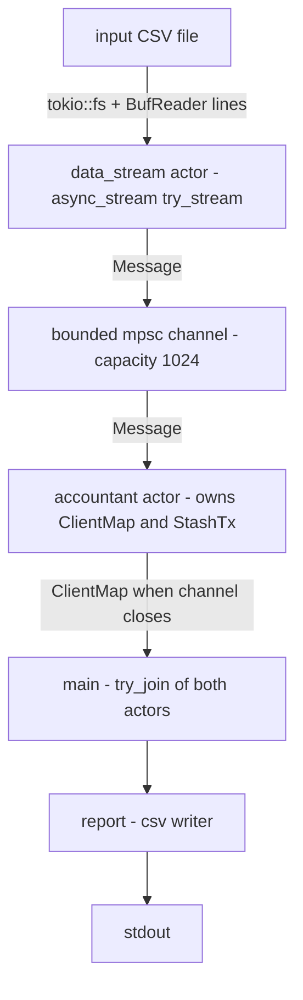

# toymachine

**Author:** Vojtěch Parkán / czarte@github

A toy payments engine. It reads a CSV file of transactions (deposits,
withdrawals, disputes, resolves and chargebacks), applies them to client
accounts, and writes the final balance of every client as CSV to stdout.

---

## Build & run

```sh
# build
cargo build --release

# run: the single argument is the input CSV, the report goes to stdout
cargo run --release -- input.csv > output.csv

# run: the as debug with  single argument is the input CSV, the report goes to stdout
cargo run -- input.csv > output.csv

# or run the compiled binary directly
./target/release/toymachine input.csv > output.csv

# tests (unit + integration), lints, formatting
cargo test
cargo clippy --all-targets
cargo fmt --check
```

### Exit codes

| Code | Meaning |
|------|---------|
| `0`  | Success, the report was written to stdout |
| `1`  | The input file could not be read or contains a malformed row (message on stderr, nothing on stdout) |
| `2`  | Wrong arguments (usage printed on stderr) |

---

## Async architecture

The program is built from two [Tokio](https://tokio.rs) actors connected by a
bounded `mpsc` channel:



- **`data_stream`** (`src/data_stream.rs`). `message_stream(path)` is an
  `async_stream::try_stream!` that opens the file with `tokio::fs::File` and reads
  it a line at a time with `BufReader::lines()`, so the runtime is never
  blocked by file IO. The `csv` crate trims each line and parses it into a
  record (the first non-blank line is the header), and serde deserializes the
  record into a `Message`. `run(path, sender)` forwards every message into the
  channel. The stream ends at the first IO or parse error, which is returned
  to `main`. If the accountant stops listening, the producer stops quietly.
- **Bounded channel**. When the accountant falls behind, `send().await`
  suspends the producer. This backpressure keeps memory use flat however big
  the input file is.
- **`accountant`** (`src/accountant.rs`). `run(receiver)` owns all state
  (`ClientMap` and `StashTx`) on its own, so there are no locks and no shared
  memory. Messages are applied one at a time, in arrival order, until the
  channel closes. Then the final `ClientMap` is returned.
- **`main`** (`src/main.rs`) spawns both actors and waits for them with
  `tokio::try_join!`. The report is written only if both succeed, so a
  failed run never produces a partial report.


---

## Project layout

```text
src/
  main.rs         CLI: argument parsing, wiring of the actors, exit codes
  lib.rs          crate root and re-exports
  message.rs      MessageType, Message (CSV row ↔ serde)
  data_stream.rs  data_stream actor: async CSV stream, StreamError
  accountant.rs   accountant actor: Client, Tx, ClientMap, TxMap, business rules
  stash.rs        StashTx: TTL stash for out-of-order dispute-like messages
  report.rs       CSV report writer
  README.md       original specification
tests/
  integration.rs  actors wired through the channel, plus end-to-end runs of the binary
  fixtures/       CSV fixtures used by the integration tests
```

Every module has unit tests (`#[cfg(test)] mod tests`) covering the happy
path and the edge cases. `tests/integration.rs` checks how the actors and
the compiled binary work together.

---

## License

Copyright © 2026 Vojtěch Parkán / czarte@github

This project is licensed under the
[Creative Commons Attribution 4.0 International License (CC BY 4.0)](https://creativecommons.org/licenses/by/4.0/).
You may share and adapt it for any purpose, including commercially, as long
as you give appropriate credit.

### Third-party crates

The project depends on these crates, each used under the MIT license (some
are dual-licensed and also offer Apache-2.0 or Unlicense). Their copyright
notices and license texts stay with the respective crates:

| Crate | License |
|-------|---------|
| [`tokio`](https://crates.io/crates/tokio) | MIT |
| [`tokio-stream`](https://crates.io/crates/tokio-stream) | MIT |
| [`async-stream`](https://crates.io/crates/async-stream) | MIT |
| [`rust_decimal`](https://crates.io/crates/rust_decimal) | MIT |
| [`csv`](https://crates.io/crates/csv) | MIT / Unlicense |
| [`serde`](https://crates.io/crates/serde) | MIT OR Apache-2.0 |
| [`thiserror`](https://crates.io/crates/thiserror) | MIT OR Apache-2.0 |
| [`anyhow`](https://crates.io/crates/anyhow) | MIT OR Apache-2.0 |

The MIT license requires its copyright and permission notice to be included
with any copies or substantial portions of these crates.
